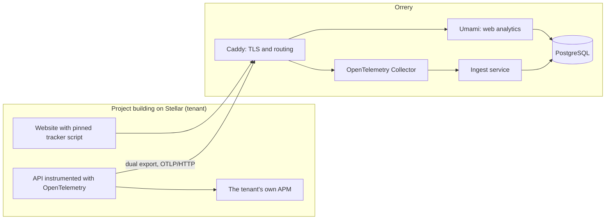

# Architecture

Orrery is one stack that a single operator can run, and later hand over, from this repo alone.

## Components

| Component | Role | Image or source |
|---|---|---|
| PostgreSQL | One instance, two databases: `umami` for web analytics, `orrery` for tenants and API metrics | `postgres:17.11-alpine` |
| Umami | Privacy-first web analytics, collected only from frontend code | `ghcr.io/umami-software/umami:3.4.1` |
| OpenTelemetry Collector | Receives OTLP over HTTP. Keeps metrics; traces, spans and logs are never stored | `otel/opentelemetry-collector-contrib:0.164.0` |
| Ingest | Orrery's own service: tenants, standardized API metrics, operator API | `services/ingest` (TypeScript, Hono, pg) |
| Caddy | Single entry point, automatic HTTPS in production | `caddy:2.11.9-alpine` |

Every image is pinned to a version. Upgrading is a reviewed change in this repo, never an automatic pull.

## Why Umami

The RFP asks for a base of either Umami or GoatCounter. Orrery uses Umami because:

- **PostgreSQL is its only database.** The RFP stores API metrics in PostgreSQL, so web and API data share one engine, one backup and one restore procedure.
- **Multi-user and team model built in.** Teams map directly to tenants, which gives tenant isolation a native starting point instead of one instance per project.
- **MIT license**, which keeps the whole monorepo under one permissive license.
- **Active project with a large user base**, so security fixes keep arriving after handover.
- **TypeScript and Node**, the same stack as the ingest service, so a single operator can maintain both.

GoatCounter is a strong option too, as a single Go binary that runs on PostgreSQL or SQLite. For this RFP the deciding factors are the shared PostgreSQL engine and the built-in team model.

## Data that is never stored

- Traces, spans and logs sent to the collector. Only derived metrics are kept.
- Raw IP addresses. The plan is to truncate them before geolocation.
- Anything that needs a client-side consent banner.

## Status

Day 1: the stack boots and each route answers through Caddy. Tenancy, the tracker script, Stellar-aware route normalization and the dashboards come next.
