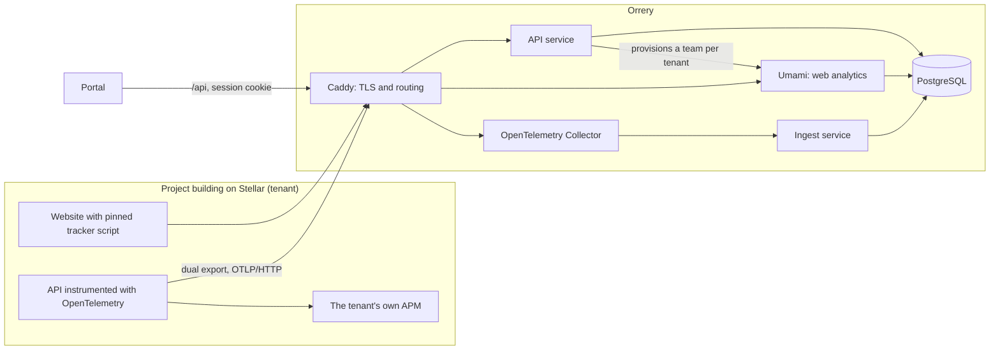

# Architecture

Orrery is one stack that a single operator can run, and later hand over, from this repo alone.

## Components

| Component | Role | Image or source |
|---|---|---|
| PostgreSQL | One instance, two databases: `umami` for web analytics, `orrery` for tenants and API metrics | `postgres:17.11-alpine` |
| Umami | Privacy-first web analytics, collected only from frontend code | `ghcr.io/umami-software/umami:3.4.1` |
| OpenTelemetry Collector | Receives OTLP over HTTP. Keeps metrics; traces, spans and logs are never stored | `otel/opentelemetry-collector-contrib:0.164.0` |
| Ingest | The ingestion path: web gate in front of Umami, OTLP key checks, metrics sink | `services/ingest` (TypeScript, Hono, pg) |
| API | Stellar sign-in, tenants, dashboards, operator API | `services/api` (TypeScript, Hono, pg) |
| Caddy | Single entry point, automatic HTTPS in production | `caddy:2.11.9-alpine` |

Every image is pinned to a version. Upgrading is a reviewed change in this repo, never an automatic pull.

## Why Umami

The RFP asks for a base of either Umami or GoatCounter. Orrery uses Umami because:

- **PostgreSQL is its only database.** The RFP stores API metrics in PostgreSQL, so web and API data share one engine, one backup and one restore procedure.
- **Multi-user and team model built in.** Teams map directly to tenants, which gives tenant isolation a native starting point instead of one instance per project.
- **MIT license**, which keeps the whole monorepo under one permissive license.
- **Active project with a large user base**, so security fixes keep arriving after handover.
- **TypeScript and Node**, the same stack as the ingest service, so a single operator can maintain both.

GoatCounter is a strong option too, as a single Go binary that runs on PostgreSQL or SQLite. For this RFP the deciding factors are the shared PostgreSQL engine and the built-in team model.

## Sign-in with a Stellar account

Projects and SCF operators sign in by signing a one-time message with their Stellar account, following [SEP-53](https://github.com/stellar/stellar-protocol/blob/master/ecosystem/sep-0053.md). No passwords, no email.

1. `POST /api/auth/challenge` with the account returns a message that names the portal's domain, the account, a random nonce and a five-minute expiry.
2. The wallet signs `SHA256("Stellar Signed Message:\n" + message)` with ed25519.
3. `POST /api/auth/verify` checks the signature, then burns the challenge in a single statement, so each signature works exactly once.
4. The session cookie is `HttpOnly`, `Secure` and `SameSite=Lax`. The database stores only its SHA-256 hash, so sessions can be revoked.

Operators are Stellar accounts listed in `ORRERY_OPERATORS`. The role is checked on every request, so removing an account takes effect immediately.

## Tenant isolation

Isolation is enforced twice:

- **In the API.** Tenant routes live under `/me` and take no tenant ID: the tenant always comes from the session. Only operators reach `/ops`.
- **In Umami.** Enrolling a project creates its own Umami team and a `team-view-only` Umami user in it. The API reads a tenant's web analytics as that user, so Umami itself refuses another team's data even if the API had a bug. The user's password is stored encrypted with AES-256-GCM under `ORRERY_SECRET_KEY`.

Enrollment is open by default. Setting `enrollment_mode` to `approval` puts new projects in `pending` until an operator approves them.

## Data that is never stored

- Traces, spans and logs sent to the collector. Only derived metrics are kept.
- Raw IP addresses. The plan is to truncate them before geolocation.
- Anything that needs a client-side consent banner.

## Status

- Day 1: the stack boots and each route answers through Caddy.
- Day 2: Stellar sign-in, sessions, self-service enrollment with a Umami team per tenant, and the operator's tenant list.
- Next: the web gate and pinned tracker script, the OTLP path with Stellar-aware route normalization, and the dashboards.
